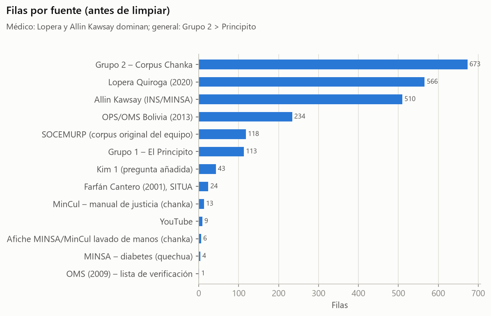
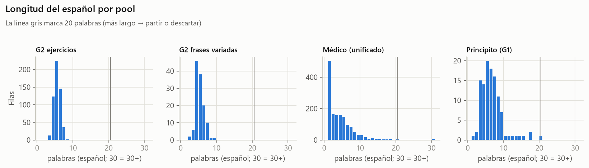
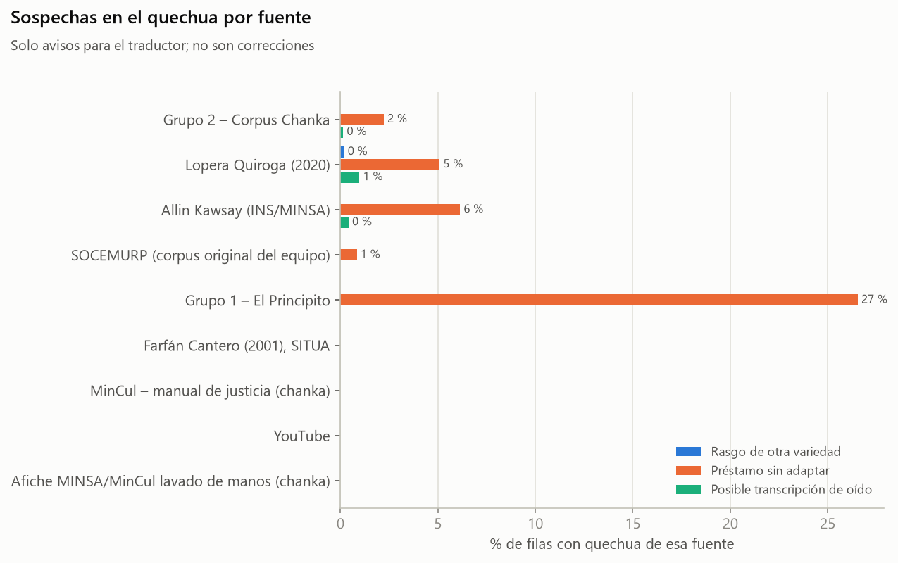
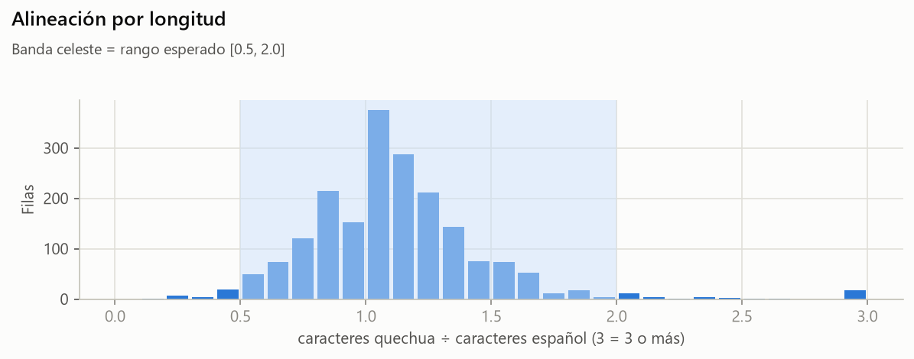
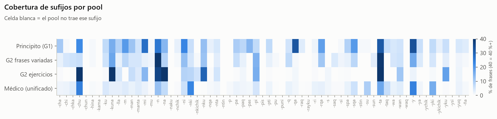
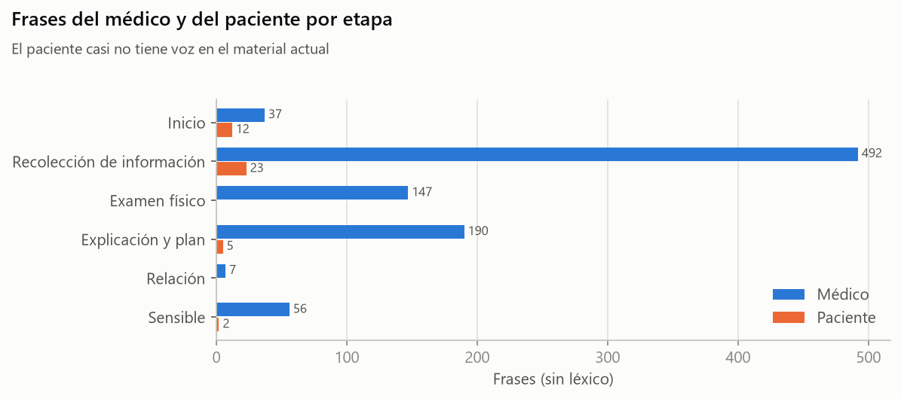

# EDA del corpus (F3) — antes de limpiar

Generado por `scripts/03_eda.py` desde el checkpoint F2 (2026-10-15). Todo se mide **antes** de la limpieza (F4). Las cifras de rasgos del quechua son **sospechas automáticas**: Claude no es hablante de chanka.

## 1. Cuántas filas hay y de dónde salen

| Dominio | Pool | Filas |
|---|---|---|
| General | G2 ejercicios | 545 |
| General | G2 frases variadas | 128 |
| General | Principito (G1) | 113 |
| Médico | Médico (unificado) | 1528 |

- **General** = Principito (traducción automática) + Grupo 2. **Médico** = vocabulario unificado (1 528 filas).
- Grupo 2 incluye 4 filas que no son oraciones (F-0517 vacía y 3 de bibliografía); se descartan en F4.

### Fuente

| Fuente | Filas | % |
|---|---|---|
| Grupo 2 – Corpus Chanka | 673 | 29.1 |
| Lopera Quiroga (2020) | 566 | 24.5 |
| Allin Kawsay (INS/MINSA) | 510 | 22.0 |
| OPS/OMS Bolivia (2013) | 234 | 10.1 |
| SOCEMURP (corpus original del equipo) | 118 | 5.1 |
| Grupo 1 – El Principito | 113 | 4.9 |
| Kim 1 (pregunta añadida) | 43 | 1.9 |
| Farfán Cantero (2001), SITUA | 24 | 1.0 |
| MinCul – manual de justicia (chanka) | 13 | 0.6 |
| YouTube | 9 | 0.4 |
| Afiche MINSA/MinCul lavado de manos (chanka) | 6 | 0.3 |
| MINSA – diabetes (quechua) | 4 | 0.2 |
| OMS (2009) – lista de verificación | 1 | 0.0 |

### Variedad de la fuente

| Variedad de la fuente | Filas | % |
|---|---|---|
| chanka (frases del equipo, sin validar) | 673 | 29.1 |
| collao/Puno, normalizado a chanka por reglas | 566 | 24.5 |
| sin confirmar (web INS/MINSA) | 510 | 22.0 |
| boliviano (solo se tomó el español) | 234 | 10.1 |
| chanka (declarada por el manual) | 118 | 5.1 |
| máquina (NLLB-200 1.3B → quy) | 113 | 4.9 |
| — (solo español) | 44 | 1.9 |
| cusqueño, normalizado a chanka por reglas | 24 | 1.0 |
| chanka oficial (MinCul) | 13 | 0.6 |
| sin confirmar | 9 | 0.4 |
| chanka oficial (MINSA/MinCul) | 6 | 0.3 |
| sin confirmar (MINSA) | 4 | 0.2 |

### Tipo de borrador

| Tipo de borrador | Filas | % |
|---|---|---|
| ejercicio generado | 545 | 23.6 |
| normalizado de Lopera | 510 | 22.0 |
| Allin Kawsay (transcripción) | 472 | 20.4 |
| ninguno | 373 | 16.1 |
| MINEDU | 127 | 5.5 |
| SOCEMURP | 118 | 5.1 |
| traductor automático Rosettia | 113 | 4.9 |
| normalizado de Farfán (cusqueño) | 24 | 1.0 |
| fuente chanka oficial | 19 | 0.8 |
| YouTube (transcripción) | 9 | 0.4 |
| MINSA (material en quechua) | 4 | 0.2 |

### Estado en el unificado (solo médico)

| Estado en el unificado (solo médico) | Filas | % |
|---|---|---|
| Final – corregido/normalizado a chanka | 522 | 34.2 |
| Pendiente – sin traducción chanka | 361 | 23.6 |
| Final – coincide en los Excel | 281 | 18.4 |
| Final – forma del libro compatible con chanka | 122 | 8.0 |
| Revisar – duda de traducción | 89 | 5.8 |
| Revisar – adaptación propuesta | 72 | 4.7 |
| Final – única fuente | 58 | 3.8 |
| Final – fuente chanka oficial | 12 | 0.8 |
| Pendiente – no usar (ver observación) | 11 | 0.7 |

### Etapa de la consulta (médico, mapeo §11.3)

| Etapa | Filas | % |
|---|---|---|
| Léxico | 527 | 34.5 |
| Recolección de información | 515 | 33.7 |
| Explicación y plan | 207 | 13.5 |
| Examen físico | 161 | 10.5 |
| Sensible | 59 | 3.9 |
| Inicio | 50 | 3.3 |
| Relación | 7 | 0.5 |
| Sin sección | 2 | 0.1 |

### Rol (médico, heurística)

| Rol | Filas | % |
|---|---|---|
| Médico | 941 | 61.6 |
| — | 545 | 35.7 |
| Paciente | 42 | 2.7 |

> «—» = palabra suelta o léxico (no tiene hablante). Rol se decide por el español: preguntas y órdenes → Médico; 1.ª persona («me duele», «tengo», «sí, …») → Paciente. Ver `scripts/heuristicas.py`.

### Secciones del unificado (las 30 más grandes)

| Sección | Filas |
|---|---|
| Vocabulario médico (palabras sueltas) | 285 |
| Examen físico: indicaciones | 130 |
| Síntomas generales | 122 |
| Vocabulario (Allin Kawsay) | 120 |
| Tratamiento e indicaciones | 98 |
| Lopera – Anexo. Vocabulario general | 62 |
| Sistema digestivo | 59 |
| Antecedentes | 59 |
| Sistema cardiorrespiratorio | 52 |
| Promoción de la salud y prevención | 47 |
| Indagar el síntoma: tiempo y características | 44 |
| Salud sexual y reproductiva | 40 |
| Métodos anticonceptivos | 32 |
| Filiación (datos generales) | 28 |
| Lopera – Anexo. Alimentos y relacionados | 28 |
| Exámenes auxiliares | 22 |
| Motivo, evolución y dolor | 22 |
| Sistema urinario | 21 |
| Diagnóstico | 20 |
| Motivo de consulta y enfermedad actual | 19 |
| Violencia | 19 |
| Salud mental (estado psicológico) | 18 |
| Presentación y saludo | 17 |
| Sistema nervioso | 16 |
| Ojos | 15 |
| Antecedentes y entorno | 14 |
| Lopera – Anexo. Colores | 13 |
| Lopera – Anexo. Números | 10 |
| Reproducción y embarazo | 9 |
| Tranquilizar al paciente | 7 |

## 2. Longitudes (palabras y caracteres)

| Pool | Lado | Filas | Mín. pal. | Mediana pal. | P90 pal. | Máx. pal. | Mediana car. | Máx. car. |
|---|---|---|---|---|---|---|---|---|
| G2 ejercicios | español | 545 | 3 | 5.0 | 6.0 | 8 | 27.0 | 40 |
| G2 ejercicios | quechua | 545 | 2 | 4.0 | 5.0 | 7 | 32.0 | 52 |
| G2 frases variadas | español | 124 | 2 | 5.0 | 6.0 | 9 | 26.0 | 44 |
| G2 frases variadas | quechua | 124 | 1 | 3.0 | 4.0 | 8 | 27.0 | 51 |
| Médico (unificado) | español | 1528 | 0 | 3.0 | 8.0 | 45 | 17.0 | 255 |
| Médico (unificado) | quechua | 1156 | 1 | 2.0 | 4.0 | 17 | 16.0 | 144 |
| Principito (G1) | español | 113 | 1 | 6.0 | 9.0 | 20 | 35.0 | 107 |
| Principito (G1) | quechua | 113 | 1 | 4.0 | 6.8 | 14 | 37.0 | 113 |

- Oraciones con más de 20 palabras en español: **17** (Médico (unificado): 17). Las 5 más largas:

  - `QCH-0544` (45 pal.): «Un personal de salud se pondrá en contacto con usted para monitorear su estado de salud, vía telefónica y/o de manera presencial, para evaluar si tiene factores…»
  - `QCH-0483` (40 pal.): «Debe tomarse la temperatura dos veces al día (mañana y tarde), y estar atento al desarrollo de cualquier otro síntoma de COVID-19 (tos, dolor de garganta, cefal…»
  - `QCH-0478` (39 pal.): «Cuarentena significa que debe permanecer en casa, estar atento al desarrollo de cualquier síntoma de COVID-19, usar mascarilla de manera constante, lavado de ma…»
  - `QCH-0520` (33 pal.): «Si desarrolla algún síntoma, deberá notificarlo inmediatamente en la App “Perú en tus manos” o también a través de las líneas 113 (MINSA), 107 (Essalud) y los t…»
  - `QCH-0522` (31 pal.): «Si sus síntomas empeoran o son graves deberá buscar atención médica de emergencia en un establecimiento de salud. Estos síntomas incluyen: dificultad para respi…»

## 3. Palabras sueltas vs. frases; preguntas, afirmaciones y órdenes

| Pool | afirmación | orden | palabra | pregunta |
|---|---|---|---|---|
| G2 ejercicios | 545 | 0 | 0 | 0 |
| G2 frases variadas | 104 | 4 | 0 | 16 |
| Médico (unificado) | 305 | 99 | 509 | 615 |
| Principito (G1) | 102 | 0 | 1 | 10 |

- Palabras sueltas (1 palabra) en el médico: **509** → no se graban solas (§10.2): van a `Lexico`.
- Frases de 2–3 palabras en el médico: **324** (muchas son términos: «dolor de cabeza»).

## 4. Duplicados exactos y casi duplicados

| Pool | Filas | Español repetido (exacto) | Quechua repetido (exacto) | Grupos de casi duplicados (≥90) | Sobrarían (>2 por grupo) |
|---|---|---|---|---|---|
| G2 ejercicios | 545 | 1 | 30 | 64 | 29 |
| G2 frases variadas | 124 | 0 | 1 | 1 | 1 |
| Médico (unificado) | 1528 | 7 | 79 | 27 | 10 |
| Principito (G1) | 113 | 0 | 0 | 0 | 0 |

- «Exacto» = igual tras normalizar (minúsculas, sin tildes ni signos).
- Casi duplicado = similitud del español ≥ 90 **y** misma polaridad (sí/no) **y** mismos números (decisión propia: «ellos bajan al río» y «ellos no bajan al río» no son paráfrasis). Se conservan hasta 2 por grupo, salvo que tengan el **mismo borrador quechua** (entonces queda 1: grabar dos veces lo mismo no aporta).
- Quechua repetido con español distinto es típico de los ejercicios del Grupo 2 («ellos/ellas bajan al río» → «Paykuna mayuman uraykunku»).

  - `F-0449` «mamá cocina pescado.» → «Mamay challwata yanun.»
  - `F-0189` «él camina muy rápido.» → «Pay ancha utqayta purin.»
  - `F-0167` «ella camina muy rápido.» → «Pay ancha utqayta purin.»
  - `F-0564` «ella sube al segundo piso.» → «Pay iskay pisuman siqan.»
  - `F-0581` «él sube al segundo piso.» → «Pay iskay pisuman siqan.»
  - `F-0128` «ella no baila con alegría.» → «Pay kusiywan mana tusunchu.»

## 5. Rasgos no chanka y letras fuera de la convención, por fuente

| Fuente | Filas con quechua | Glotal./aspir. | Vocal e/o | c/qu/j/hu o letra ajena | Rasgo de otra variedad | Préstamo sin adaptar | Posible transcripción de oído |
|---|---|---|---|---|---|---|---|
| Grupo 2 – Corpus Chanka | 672 | 0 % | 0 % | 0 % | 0 % | 2 % | 0 % |
| Lopera Quiroga (2020) | 510 | 0 % | 0 % | 0 % | 0 % | 5 % | 1 % |
| Allin Kawsay (INS/MINSA) | 472 | 0 % | 0 % | 0 % | 0 % | 6 % | 0 % |
| SOCEMURP (corpus original del equipo) | 118 | 0 % | 0 % | 0 % | 0 % | 1 % | 0 % |
| Grupo 1 – El Principito | 113 | 0 % | 3 % | 1 % | 0 % | 27 % | 0 % |
| Farfán Cantero (2001), SITUA | 24 | 0 % | 0 % | 0 % | 0 % | 0 % | 0 % |
| MinCul – manual de justicia (chanka) | 13 | 0 % | 0 % | 0 % | 0 % | 0 % | 0 % |
| YouTube | 9 | 0 % | 0 % | 0 % | 0 % | 0 % | 0 % |
| Afiche MINSA/MinCul lavado de manos (chanka) | 6 | 0 % | 0 % | 0 % | 0 % | 0 % | 0 % |
| MINSA – diabetes (quechua) | 4 | 0 % | 0 % | 0 % | 0 % | 0 % | 0 % |

- Glotalizadas/aspiradas, e/o y escritura castellana se **corrigen mecánicamente** en F4 (§10.3, registradas en `Cambios`). Lo demás (variedad, préstamos, transcripción) **solo se marca** en `QA` para el traductor.
- El unificado ya había normalizado casi todo: lo que queda allí es poco. Los ejercicios y frases del Grupo 2 están limpios en ortografía; el Principito concentra los préstamos (traducción automática).

## 6. Relación de longitud quechua/español (alineación)

- Relación en caracteres (quechua ÷ español): mediana **1.07**, P5 0.62, P95 1.67.
- Fuera de [0.5, 2.0]: **64** filas (Médico (unificado): 62, Principito (G1): 2). Casi todas son palabras sueltas o frases muy cortas, donde la relación es inestable. Ejemplos de frases:

  - 0.20 · `QCH-0195` «Siéntate (si está echado)» ↔ «Tiyay»
  - 0.40 · `QCH-0761` «¿Ha notado que desde que se le quitó el apetito (deseo de comer) es qu» ↔ «¿Mana mikusqaykimanta tulluyankichu?»
  - 0.42 · `QCH-0284` «Ladéate (Ponte de costado)» ↔ «Waqtampakuy»
  - 0.49 · `QCH-0719` «¿La tos se acompaña de dolor hacia alguna parte de la espalda (tórax)?» ↔ «¿Uhunki hina wasaykichu nanasunki?»
  - 0.49 · `QCH-0748` «¿Se le hinchan los pies por las tardes o es que ya los pies los tiene » ↔ «¿Chakiyki punkisunkichu o punkisqapuni kachkan?»
  - 0.49 · `QCH-0809` «¿Ha notado que le baja humedad por los genitales?» ↔ «¿Humpinchu genitalniyki?»

- Números que no coinciden español↔quechua: **1** filas; sospechas de sentido (tipo *pisi*/*achka*, *wata*/*killa*, negación): **171** filas.

## 7. Vocabulario del quechua

| Pool | Palabras (tokens) | Palabras distintas | Distintas no halladas en AmericasNLP/diccionarios | Ejemplos |
|---|---|---|---|---|
| G2 ejercicios | 2198 | 430 | 2 % | awilunwan, kartata, mamaquchapi, muchilata, pachamamata, pilikulata, qamkunapura, riwistata |
| G2 frases variadas | 442 | 309 | 3 % | awilu, ispiritu, ispiritun, nisisitani, pachamamamanta, qaynunchaw, rimuwan, waqyanankupaq |
| Médico (unificado) | 2688 | 1471 | 10 % | aaaaaaa, akakiswanchu, akullichkankichu, akullinki, altuman, amalluka, amuqlli, amuqllu |
| Principito (G1) | 486 | 357 | 3 % | carnakunaqa, chaqurunki, hamunmankuñam, iskayrayani, millqukuq, musyaykachirqa, pintur, qusqay |

- Léxico de referencia: JW300 quy (palabras que aparecen 2+ veces), diccionario MINEDU (PDF y AmericasNLP), Dict_misc, manual MinCul, afiche y material de diabetes en quechua; se consideran solo formas escritas con el alfabeto chanka. Una palabra cuenta como hallada si ella o su raíz (quitando sufijos) aparece. «No hallada» no significa error: el léxico médico casi no está en esos textos.

**Las 25 palabras quechuas más frecuentes:** mana (289), paykuna (105), huk (96), pay (88), ñuqayku (88), warma (82), warmi (81), warmakuna (80), qam (48), ñuqa (46), qari (45), sapa (37), hina (34), qamkuna (32), nanasunki (30), o (30), punchaw (29), kay (29), ama (28), kachkan (27), ancha (26), wasipi (24), kunan (24), utqayta (23), kachkanki (23)

## 8. Cobertura de sufijos (§11.1): qué enseña cada pool

| Pool | Sufijos presentes | Ausentes |
|---|---|---|
| Principito (G1) | 46 de 63 | -chka, -chun, -kama, -naku, -nkichik, -ntin, -p, -pis, -pu, -puni, -rayku, -s, -saq, -sun, -waq, -ychik, -ysi |
| G2 frases variadas | 44 de 63 | -chun, -kama, -naku, -nqa, -ntin, -p, -pas, -pis, -puni, -raq, -rayku, -s, -stin, -su, -taq, -waq, -ychik, -ykichik, -ysi |
| G2 ejercicios | 34 de 63 | -chi, -chun, -hina, -kama, -m, -naku, -nchik, -ntin, -p, -pas, -pis, -pu, -puni, -raq, -rayku, -rqa, -saq, -sqa, -stin, -su, -sun, -taq, -wa, -waq, -ya, -ychik, -ykichik, -ysi, -ña |
| Médico (unificado) | 57 de 63 | -chun, -ntin, -pis, -stin, -ychik, -ysi |

> Segmentación **heurística** (quita sufijos desde el final, el más largo primero, hasta una raíz del diccionario). Es aproximada: confunde homófonos (-n persona/posesivo, -y imperativo/posesivo, -pa genitivo/derivativo). Sirve para comparar pools, no como análisis morfológico.

## 9. Cobertura clínica

### Frases por etapa y rol (sin léxico)

| Etapa | Médico | Paciente |
|---|---|---|
| Examen físico | 147 | 0 |
| Explicación y plan | 190 | 5 |
| Inicio | 37 | 12 |
| Recolección de información | 492 | 23 |
| Relación | 7 | 0 |
| Sensible | 56 | 2 |
| Sin sección | 1 | 0 |

### Material para la consulta completa de B01 (§11.2)

| Etapa (B01) | Médico | Paciente |
|---|---|---|
| Inicio | 37 | 12 |
| Motivo de consulta | 15 | 7 |
| Caracterizar el síntoma | 142 | 9 |
| Síntomas asociados | 80 | 4 |
| Examen físico | 84 | 0 |
| Explicación, plan y cierre | 68 | 0 |

- Frases del **paciente** en todo el unificado: **42** frente a **930** del médico.
- Escenarios **sin ninguna frase del paciente**: 86 de 104. Los que sí tienen:

| Escenario | Frases del paciente |
|---|---|
| Síntomas generales › Dolor: presencia y localización | 8 |
| Filiación (datos generales) › Estado civil y acompañante | 5 |
| Tratamiento e indicaciones › Hospitalización, procedimientos y cuidados | 5 |
| Filiación (datos generales) › Nombre, edad e identificación | 3 |
| Filiación (datos generales) › Procedencia y residencia | 3 |
| Motivo de consulta y enfermedad actual › Cómo se siente el paciente | 3 |
| Motivo de consulta y enfermedad actual › Tiempo de enfermedad y forma de inicio | 3 |
| Sistema cardiorrespiratorio › Tos y flema | 2 |
| Presentación y saludo › Saludo y trato | 1 |
| Motivo de consulta y enfermedad actual › Motivo de consulta | 1 |
| Salud sexual y reproductiva › Embarazo y parto | 1 |
| Antecedentes › Familia | 1 |
| Salud sexual y reproductiva › Flujo, molestias genitales y control ginecológico | 1 |
| Síntomas generales › Dolor: horario, intensidad y tipo | 1 |
| Sistema digestivo › Gases, hinchazón del abdomen, eructos y saliva | 1 |
| Síntomas generales › Mareos | 1 |
| Sistema digestivo › Dolor de estómago (abdomen) | 1 |
| Salud mental (estado psicológico) › Ánimo, conducta y percepciones | 1 |

### Temas clave (búsqueda por palabras en el español)

| Tema | Frases | Médico | Paciente |
|---|---|---|---|
| fiebre | 5 | 5 | 0 |
| tos | 16 | 15 | 1 |
| vómito/náusea | 9 | 9 | 0 |
| diarrea/deposiciones | 22 | 22 | 0 |
| dolor de cabeza | 6 | 4 | 2 |
| dolor de estómago/barriga | 24 | 20 | 4 |
| orina | 33 | 33 | 0 |
| respirar/falta de aire | 30 | 30 | 0 |
| alergias | 2 | 2 | 0 |
| medicamentos/dosis | 17 | 17 | 0 |
| embarazo | 10 | 9 | 1 |
| niños | 33 | 32 | 1 |
| sangrado | 25 | 25 | 0 |
| desmayo/convulsión | 4 | 4 | 0 |
| deshidratación | 2 | 1 | 1 |
| volver/control | 6 | 6 | 0 |
| ¿entendió? | 1 | 1 | 0 |
| tranquilizar | 4 | 4 | 0 |

## 10. EDA previo de un compañero (solo precedente)

Existe un EDA anterior (`Fuentes/Trabajo - Otro Compañero/[Vibe]EDA_Corpus_NLP.ipynb` + `Corpus_Recopilado.xlsx`). No se usó como fuente de datos ni de alertas. Diferencias principales: usaba la hoja médica antigua del Grupo 3 (no el unificado), y preseleccionaba 100 + 100 + 100 frases por cobertura de palabras del **español** de unas flashcards. Aquí se usa el unificado (D10), la proporción 70/30 por bloque (D1), cobertura de **sufijos del quechua** para la parte general (§11.1) y el flujo de consulta para la parte médica (§11.2).

## 11. Conclusiones (en simple)

**Qué se descarta (estimado; F4 da la cifra exacta):**
- 11 filas «Pendiente – no usar» del unificado (títulos), la fila vacía F-0517 y las 3 filas de bibliografía del Grupo 2.
- Repetidos exactos: general 1, médico 7.
- Casi duplicados que pasan de 2 por significado: general 30 (sobre todo ejercicios del Grupo 2), médico 10.
- Oraciones de más de 20 palabras que no sean listas partibles (17 candidatas).
- Las 509 palabras sueltas del médico no se descartan: pasan a `Lexico`; las prioritarias vuelven como frases portadoras (F5).

**Qué falta:**
- **Voz del paciente.** Hay ~42 frases del paciente para todo el corpus; cada bloque necesita ~30. F5 debe redactar en español las respuestas del paciente a las preguntas de los bloques planificados.
- Temas con poco o nada: ver la tabla de temas clave (alergias, deshidratación, niños, embarazo con sangrado, «¿entendió?»).
- Quechua confiable: ninguna fila es gold. El Principito es traducción automática con préstamos; el médico viene en gran parte de Lopera (collao) normalizado por reglas.
- Los ejercicios del Grupo 2 son muy repetitivos: tras quitar casi duplicados quedan bastantes menos.

**Cuántos bloques caben (estimado):**
- Parte general utilizable ≈ **751** oraciones → **5 bloques** de 140.
- Parte médica utilizable (frases ≤ 20 palabras, sin léxico ni repetidos) ≈ **948** → alcanzaría para 15 bloques de 60, pero la mitad debe ser del paciente, así que el límite real lo pone lo que se redacte en F5.
- **La parte general es la que limita: ~5 bloques** con el material actual. Para más, habría que decidir P4 (AmericasNLP) con Juan.
- El diccionario MINEDU en PDF tiene texto y se usó para P6: las frases del Grupo 2 **no** aparecen como ejemplos del diccionario (solo 2 coinciden). Son frases del equipo con vocabulario chanka; se usan igual, con `Origen_verificado = No`.
