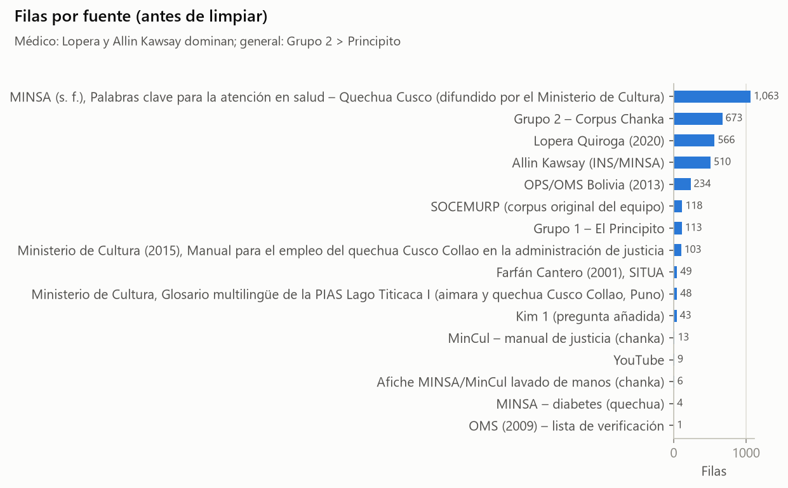
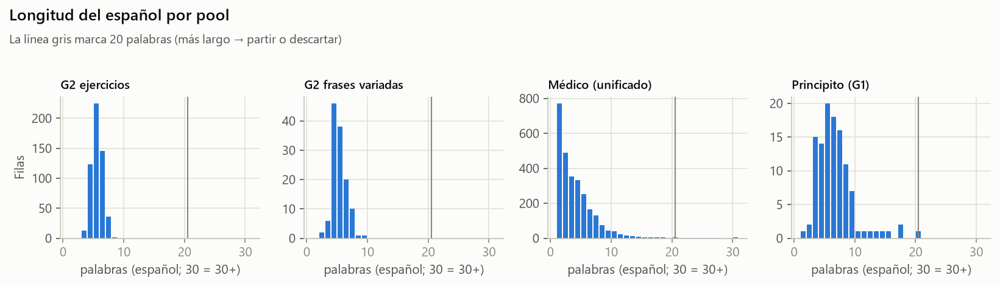
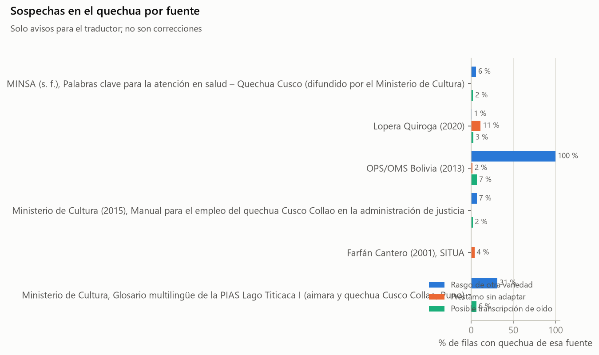
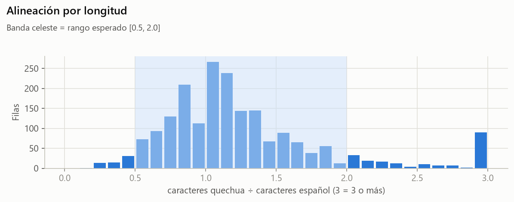
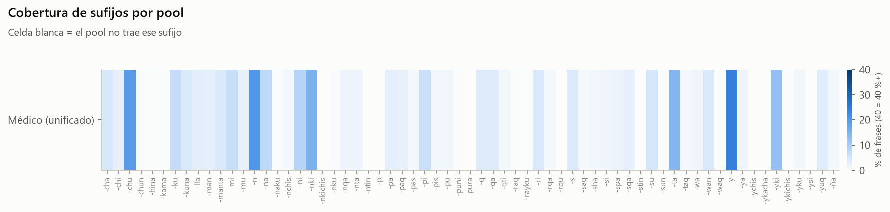
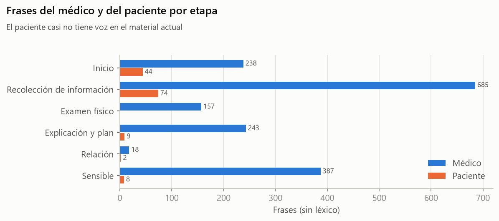

# EDA del corpus (F3) — antes de limpiar

Generado por `scripts/03_eda.py` desde el checkpoint F2 (2026-11-05). Todo se mide **antes** de la limpieza (F4). Las cifras de rasgos del quechua son **sospechas automáticas**: Claude no es hablante de quechua. Variedad del corpus: **quechua collao (Cusco–Collao)**; del material chanka solo se usa el español.

## 1. Cuántas filas hay y de dónde salen

| Dominio | Pool | Filas |
|---|---|---|
| General | G2 ejercicios | 545 |
| General | G2 frases variadas | 128 |
| General | Principito (G1) | 113 |
| Médico | Médico (unificado) | 2767 |

- **General** = Principito + Grupo 2 (solo español). **Médico** = vocabulario unificado (1 528 filas) + 25 frases de Farfán que el unificado no tenía.
- Grupo 2 incluye 4 filas que no son oraciones (F-0517 vacía y 3 de bibliografía); se descartan en F4.

### Fuente

| Fuente | Filas | % |
|---|---|---|
| MINSA (s. f.), Palabras clave para la atención en salud – Quechua Cusco (difundido por el Ministerio de Cultura) | 1063 | 29.9 |
| Grupo 2 – Corpus Chanka | 673 | 18.9 |
| Lopera Quiroga (2020) | 566 | 15.9 |
| Allin Kawsay (INS/MINSA) | 510 | 14.4 |
| OPS/OMS Bolivia (2013) | 234 | 6.6 |
| SOCEMURP (corpus original del equipo) | 118 | 3.3 |
| Grupo 1 – El Principito | 113 | 3.2 |
| Ministerio de Cultura (2015), Manual para el empleo del quechua Cusco Collao en la administración de justicia | 103 | 2.9 |
| Farfán Cantero (2001), SITUA | 49 | 1.4 |
| Ministerio de Cultura, Glosario multilingüe de la PIAS Lago Titicaca I (aimara y quechua Cusco Collao, Puno) | 48 | 1.4 |
| Kim 1 (pregunta añadida) | 43 | 1.2 |
| MinCul – manual de justicia (chanka) | 13 | 0.4 |
| YouTube | 9 | 0.3 |
| Afiche MINSA/MinCul lavado de manos (chanka) | 6 | 0.2 |
| MINSA – diabetes (quechua) | 4 | 0.1 |
| OMS (2009) – lista de verificación | 1 | 0.0 |

### Variedad de la fuente

| Variedad de la fuente | Filas | % |
|---|---|---|
| collao cusqueño, oficial (traducción del Estado) | 1214 | 34.2 |
| — (solo español; su quechua era chanka y no se usa) | 823 | 23.2 |
| collao (Puno/Cusco), forma original del libro | 566 | 15.9 |
| — (solo español; su quechua era chanka de Huancavelica, transcrito de oído) | 510 | 14.4 |
| quechua sureño boliviano (familia collao) | 234 | 6.6 |
| — (solo español; su quechua era de traductor automático chanka quy) | 113 | 3.2 |
| collao cusqueño, forma original | 49 | 1.4 |
| — (solo español) | 44 | 1.2 |

### Tipo de borrador

| Tipo de borrador | Filas | % |
|---|---|---|
| ninguno | 1552 | 43.7 |
| fuente collao oficial | 1214 | 34.2 |
| Lopera (libro, collao) | 564 | 15.9 |
| OPS/OMS Bolivia (sureño boliviano) | 174 | 4.9 |
| Farfán (cusqueño, original) | 49 | 1.4 |

### Estado en el unificado (solo médico)

| Estado en el unificado (solo médico) | Filas | % |
|---|---|---|
| (vacío) | 1239 | 44.8 |
| Final – corregido/normalizado a chanka | 522 | 18.9 |
| Pendiente – sin traducción chanka | 361 | 13.0 |
| Final – coincide en los Excel | 281 | 10.2 |
| Final – forma del libro compatible con chanka | 122 | 4.4 |
| Revisar – duda de traducción | 89 | 3.2 |
| Revisar – adaptación propuesta | 72 | 2.6 |
| Final – única fuente | 58 | 2.1 |
| Final – fuente chanka oficial | 12 | 0.4 |
| Pendiente – no usar (ver observación) | 11 | 0.4 |

### Etapa de la consulta (médico, mapeo §11.3)

| Etapa | Filas | % |
|---|---|---|
| Recolección de información | 842 | 30.4 |
| Léxico | 620 | 22.4 |
| Sensible | 522 | 18.9 |
| Inicio | 320 | 11.6 |
| Explicación y plan | 270 | 9.8 |
| Examen físico | 171 | 6.2 |
| Relación | 20 | 0.7 |
| Sin sección | 2 | 0.1 |

### Rol (médico, heurística)

| Rol | Filas | % |
|---|---|---|
| Médico | 1757 | 63.5 |
| — | 867 | 31.3 |
| Paciente | 143 | 5.2 |

> «—» = palabra suelta o léxico (no tiene hablante). Rol se decide por el español: preguntas y órdenes → Médico; 1.ª persona («me duele», «tengo», «sí, …») → Paciente. Ver `scripts/heuristicas.py`.

### Secciones del unificado (las 30 más grandes)

| Sección | Filas |
|---|---|
| Salud sexual y reproductiva | 494 |
| Vocabulario médico (palabras sueltas) | 378 |
| Presentación y saludo | 256 |
| Motivo de consulta | 218 |
| Antecedentes | 148 |
| Síntomas generales | 140 |
| Tratamiento e indicaciones | 132 |
| Examen físico: indicaciones | 131 |
| Vocabulario (Allin Kawsay) | 120 |
| Lopera – Anexo. Vocabulario general | 62 |
| Sistema digestivo | 61 |
| Métodos anticonceptivos | 61 |
| Sistema cardiorrespiratorio | 52 |
| Promoción de la salud y prevención | 47 |
| Indagar el síntoma: tiempo y características | 44 |
| Filiación | 35 |
| Exámenes auxiliares | 31 |
| Filiación (datos generales) | 28 |
| Lopera – Anexo. Alimentos y relacionados | 28 |
| Violencia | 28 |
| Motivo, evolución y dolor | 22 |
| Sistema urinario | 21 |
| Tranquilizar al paciente | 20 |
| Diagnóstico | 20 |
| Motivo de consulta y enfermedad actual | 19 |
| Salud mental (estado psicológico) | 18 |
| Sistema nervioso | 16 |
| Ojos | 15 |
| Antecedentes y entorno | 14 |
| Lopera – Anexo. Colores | 13 |

## 2. Longitudes (palabras y caracteres)

| Pool | Lado | Filas | Mín. pal. | Mediana pal. | P90 pal. | Máx. pal. | Mediana car. | Máx. car. |
|---|---|---|---|---|---|---|---|---|
| G2 ejercicios | español | 545 | 3 | 5.0 | 6.0 | 8 | 27.0 | 40 |
| G2 frases variadas | español | 124 | 2 | 5.0 | 6.0 | 9 | 26.0 | 44 |
| Médico (unificado) | español | 2767 | 0 | 3.0 | 7.0 | 45 | 16.0 | 255 |
| Médico (unificado) | quechua | 2001 | 1 | 2.0 | 5.0 | 16 | 20.0 | 164 |
| Principito (G1) | español | 113 | 1 | 6.0 | 9.0 | 20 | 35.0 | 107 |

- Oraciones con más de 20 palabras en español: **17** (Médico (unificado): 17). Las 5 más largas:

  - `QCH-0544` (45 pal.): «Un personal de salud se pondrá en contacto con usted para monitorear su estado de salud, vía telefónica y/o de manera presencial, para evaluar si tiene factores…»
  - `QCH-0483` (40 pal.): «Debe tomarse la temperatura dos veces al día (mañana y tarde), y estar atento al desarrollo de cualquier otro síntoma de COVID-19 (tos, dolor de garganta, cefal…»
  - `QCH-0478` (39 pal.): «Cuarentena significa que debe permanecer en casa, estar atento al desarrollo de cualquier síntoma de COVID-19, usar mascarilla de manera constante, lavado de ma…»
  - `QCH-0520` (33 pal.): «Si desarrolla algún síntoma, deberá notificarlo inmediatamente en la App “Perú en tus manos” o también a través de las líneas 113 (MINSA), 107 (Essalud) y los t…»
  - `QCH-0522` (31 pal.): «Si sus síntomas empeoran o son graves deberá buscar atención médica de emergencia en un establecimiento de salud. Estos síntomas incluyen: dificultad para respi…»

## 3. Palabras sueltas vs. frases; preguntas, afirmaciones y órdenes

| Pool | afirmación | orden | palabra | pregunta |
|---|---|---|---|---|
| G2 ejercicios | 545 | 0 | 0 | 0 |
| G2 frases variadas | 104 | 4 | 0 | 16 |
| Médico (unificado) | 1079 | 136 | 769 | 783 |
| Principito (G1) | 102 | 0 | 1 | 10 |

- Palabras sueltas (1 palabra) en el médico: **769** → no se graban solas (§10.2): van a `Lexico`.
- Frases de 2–3 palabras en el médico: **841** (muchas son términos: «dolor de cabeza»).

## 4. Duplicados exactos y casi duplicados

| Pool | Filas | Español repetido (exacto) | Quechua repetido (exacto) | Grupos de casi duplicados (≥90) | Sobrarían (>2 por grupo) |
|---|---|---|---|---|---|
| G2 ejercicios | 545 | 1 | 0 | 64 | 14 |
| G2 frases variadas | 124 | 0 | 0 | 2 | 0 |
| Médico (unificado) | 2767 | 225 | 52 | 56 | 6 |
| Principito (G1) | 113 | 0 | 0 | 0 | 0 |

- «Exacto» = igual tras normalizar (minúsculas, sin tildes ni signos).
- Casi duplicado = similitud del español ≥ 90 **y** misma polaridad (sí/no) **y** mismos números (decisión propia: «ellos bajan al río» y «ellos no bajan al río» no son paráfrasis). Se conservan hasta 2 por grupo, salvo que tengan el **mismo borrador quechua** (entonces queda 1: grabar dos veces lo mismo no aporta).
- La parte general ya no trae borrador (su quechua era chanka): ahí los casi duplicados se deciden solo por el español.

## 5. Rasgos de otra variedad (chanka/boliviano) y letras fuera de la convención collao, por fuente

| Fuente | Filas con quechua | Con glotal./aspir. (bien en collao) | Vocal e/o | c/qu/j/hu o letra ajena | Rasgo de otra variedad | Préstamo sin adaptar | Posible transcripción de oído |
|---|---|---|---|---|---|---|---|
| MINSA (s. f.), Palabras clave para la atención en salud – Quechua Cusco (difundido por el Ministerio de Cultura) | 1063 | 24 % | 0 % | 3 % | 6 % | 0 % | 3 % |
| Lopera Quiroga (2020) | 564 | 29 % | 0 % | 23 % | 1 % | 8 % | 3 % |
| OPS/OMS Bolivia (2013) | 174 | 51 % | 0 % | 0 % | 100 % | 1 % | 7 % |
| Ministerio de Cultura (2015), Manual para el empleo del quechua Cusco Collao en la administración de justicia | 103 | 14 % | 0 % | 2 % | 7 % | 0 % | 2 % |
| Farfán Cantero (2001), SITUA | 49 | 16 % | 0 % | 4 % | 0 % | 2 % | 0 % |
| Ministerio de Cultura, Glosario multilingüe de la PIAS Lago Titicaca I (aimara y quechua Cusco Collao, Puno) | 48 | 15 % | 0 % | 0 % | 31 % | 0 % | 6 % |

- En collao las glotalizadas y aspiradas **son parte del alfabeto** (no se quitan). Las vocales e/o (si se usan 3 vocales), la escritura castellana (j, c/qu/hu) y las semivocales («kunkaiki», «allyntachu») se **corrigen mecánicamente** en F4 (§10.3, registradas en `Cambios`). Lo demás (rasgos chanka o bolivianos, préstamos, transcripción) **solo se marca** en `QA`.
- Lopera (forma del libro) escribe a la castellana y con 5 vocales; OPS/OMS Bolivia trae rasgos bolivianos (j, -chka-, «machkha»); Farfán es cusqueño y es el más cercano a la convención.

## 6. Relación de longitud quechua/español (alineación)

- Relación en caracteres (quechua ÷ español): mediana **1.12**, P5 0.56, P95 2.67.
- Fuera de [0.5, 2.0]: **239** filas (Médico (unificado): 239). Casi todas son palabras sueltas o frases muy cortas, donde la relación es inestable. Ejemplos de frases:

  - 0.24 · `PCS-095-03` «El hermano de hermana» ↔ «Turay»
  - 0.24 · `PCS-095-01` «La hermana de hermana» ↔ «Ñañay»
  - 0.24 · `PCS-095-04` «La hermana de hermano» ↔ «Panay»
  - 0.25 · `QCH-1386` «¿Se pone de color morado? (hablando de otra persona)» ↔ «¿Kulliyanchu?»
  - 0.26 · `QCH-1388` «¿Se pone de color amarillo? (hablando de otra persona)» ↔ «¿Q'illuyanchu?»
  - 0.26 · `PCS-076-08` «Las personas que tienen» ↔ «Sichus»

- Números que no coinciden español↔quechua: **30** filas; sospechas de sentido (tipo *pisi*/*achka*, *wata*/*killa*, negación): **42** filas.

## 7. Vocabulario del quechua

| Pool | Palabras (tokens) | Palabras distintas | Distintas no halladas en el léxico collao | Ejemplos |
|---|---|---|---|---|
| Médico (unificado) | 5624 | 3099 | 3 % | alimento, ama, anotanayki, asuste, ayer, ayuno, años, chupo |

- Léxico de referencia **collao**: todo el quechua de Lopera (forma del libro), Farfán y OPS/OMS Bolivia, comparado sin glotales ni aspiradas y con 3 vocales (así «p'unchay» y «punchay» cuentan como la misma palabra). Es chico, porque se armó solo con fuentes collao: «no hallada» no significa error. Crecerá cuando se agreguen las fuentes de `FUENTES_COLLAO.md`.

**Las 25 palabras quechuas más frecuentes:** mana (76), o (56), kashan (42), allin (38), kani (38), hina (36), kay (31), ama (30), manan (30), ima (28), kanki (28), sapa (26), chunka (25), punchay (24), yawar (24), nanan (22), kashanki (21), punchaw (21), sichus (21), hayka (20), killa (19), chay (17), ari (17), chayqa (17), kunan (16)

## 8. Cobertura de sufijos (§11.1): qué enseña cada pool

| Pool | Sufijos presentes | Ausentes |
|---|---|---|
| Médico (unificado) | 61 de 65 | -rqu, -stin, -ychis, -ysi |

> Segmentación **heurística** (quita sufijos desde el final, el más largo primero, hasta una raíz del diccionario). Es aproximada: confunde homófonos (-n persona/posesivo, -y imperativo/posesivo, -pa genitivo/derivativo). Sirve para comparar pools, no como análisis morfológico.

## 9. Cobertura clínica

### Frases por etapa y rol (sin léxico)

| Etapa | Médico | Paciente |
|---|---|---|
| Examen físico | 157 | 0 |
| Explicación y plan | 243 | 9 |
| Inicio | 238 | 44 |
| Recolección de información | 685 | 74 |
| Relación | 18 | 2 |
| Sensible | 387 | 8 |
| Sin sección | 1 | 0 |

### Material para la consulta completa de B01 (§11.2)

| Etapa (B01) | Médico | Paciente |
|---|---|---|
| Inicio | 238 | 44 |
| Motivo de consulta | 142 | 16 |
| Caracterizar el síntoma | 155 | 13 |
| Síntomas asociados | 82 | 4 |
| Examen físico | 84 | 0 |
| Explicación, plan y cierre | 101 | 6 |

- Frases del **paciente** en todo el unificado: **137** frente a **1729** del médico.
- Escenarios **sin ninguna frase del paciente**: 84 de 110. Los que sí tienen:

| Escenario | Frases del paciente |
|---|---|
| Antecedentes › Familia | 39 |
| Presentación y saludo › Saludo y trato | 28 |
| Motivo de consulta › Motivo de consulta | 9 |
| Síntomas generales › Dolor: presencia y localización | 8 |
| Filiación (datos generales) › Estado civil y acompañante | 5 |
| Salud sexual y reproductiva › Embarazo y parto | 5 |
| Tratamiento e indicaciones › Hospitalización, procedimientos y cuidados | 5 |
| Síntomas generales › Dolor: inicio, irradiación y evolución | 4 |
| Tratamiento e indicaciones › Medicamentos y dosis | 4 |
| Filiación (datos generales) › Nombre, edad e identificación | 3 |
| Filiación (datos generales) › Procedencia y residencia | 3 |
| Motivo de consulta y enfermedad actual › Cómo se siente el paciente | 3 |
| Motivo de consulta y enfermedad actual › Tiempo de enfermedad y forma de inicio | 3 |
| Filiación › Datos personales | 3 |
| Sistema cardiorrespiratorio › Tos y flema | 2 |
| Presentación y saludo › Acceso lingüístico | 2 |
| Tranquilizar al paciente › Tranquilizar al paciente | 2 |
| Motivo de consulta y enfermedad actual › Motivo de consulta | 1 |
| Salud sexual y reproductiva › Flujo, molestias genitales y control ginecológico | 1 |
| Síntomas generales › Dolor: horario, intensidad y tipo | 1 |
| Sistema digestivo › Gases, hinchazón del abdomen, eructos y saliva | 1 |
| Síntomas generales › Mareos | 1 |
| Sistema digestivo › Dolor de estómago (abdomen) | 1 |
| Salud mental (estado psicológico) › Ánimo, conducta y percepciones | 1 |
| Violencia › Preguntas sobre violencia | 1 |
| Salud sexual y reproductiva › Menstruación y menopausia | 1 |

### Temas clave (búsqueda por palabras en el español)

| Tema | Frases | Médico | Paciente |
|---|---|---|---|
| fiebre | 6 | 6 | 0 |
| tos | 16 | 15 | 1 |
| vómito/náusea | 11 | 10 | 1 |
| diarrea/deposiciones | 24 | 24 | 0 |
| dolor de cabeza | 11 | 7 | 4 |
| dolor de estómago/barriga | 27 | 21 | 6 |
| orina | 38 | 37 | 1 |
| respirar/falta de aire | 30 | 30 | 0 |
| alergias | 2 | 2 | 0 |
| medicamentos/dosis | 29 | 28 | 1 |
| embarazo | 31 | 29 | 2 |
| niños | 65 | 54 | 11 |
| sangrado | 40 | 39 | 1 |
| desmayo/convulsión | 4 | 4 | 0 |
| deshidratación | 3 | 2 | 1 |
| volver/control | 25 | 25 | 0 |
| ¿entendió? | 3 | 2 | 1 |
| tranquilizar | 9 | 9 | 0 |

## 10. EDA previo de un compañero (solo precedente)

Existe un EDA anterior (`Fuentes/Trabajo - Otro Compañero/[Vibe]EDA_Corpus_NLP.ipynb` + `Corpus_Recopilado.xlsx`). No se usó como fuente de datos ni de alertas. Diferencias principales: usaba la hoja médica antigua del Grupo 3 (no el unificado), y preseleccionaba 100 + 100 + 100 frases por cobertura de palabras del **español** de unas flashcards. Aquí se usa el unificado (D10), la proporción 70/30 por bloque (D1), cobertura de **rasgos gramaticales** para la parte general (§11.1; medidos en el español, porque esa parte ya no trae borrador collao) y el flujo de consulta para la parte médica (§11.2).

## 11. Conclusiones (en simple)

**Qué se descarta (estimado; F4 da la cifra exacta):**
- 11 filas «Pendiente – no usar» del unificado (títulos), la fila vacía F-0517 y las 3 filas de bibliografía del Grupo 2.
- Repetidos exactos: general 1, médico 225.
- Casi duplicados que pasan de 2 por significado: general 14 (sobre todo ejercicios del Grupo 2), médico 6.
- Oraciones de más de 20 palabras que no sean listas partibles (17 candidatas).
- Las 769 palabras sueltas del médico no se descartan: pasan a `Lexico`; las prioritarias vuelven como frases portadoras (F5).

**Qué falta:**
- **Voz del paciente.** Hay ~137 frases del paciente para todo el corpus; cada bloque necesita ~30. F5 debe redactar en español las respuestas del paciente a las preguntas de los bloques planificados.
- Temas con poco o nada: ver la tabla de temas clave (alergias, deshidratación, niños, embarazo con sangrado, «¿entendió?»).
- Quechua collao: solo la parte médica tiene borradores (2001 filas: Lopera, Farfán y OPS/OMS Bolivia, en su forma original). Ninguno es gold: Lopera escribe a la castellana y tiene desalineados; OPS es boliviano. La parte general va **sin borrador** (el traductor traduce desde el español).
- Los ejercicios del Grupo 2 son muy repetitivos: tras quitar casi duplicados quedan bastantes menos.

**Cuántos bloques caben (estimado):**
- Parte general utilizable ≈ **767** oraciones → **5 bloques** de 140.
- Parte médica utilizable (frases ≤ 20 palabras, sin léxico ni repetidos) ≈ **1740** → alcanzaría para 29 bloques de 60, pero la mitad debe ser del paciente, así que el límite real lo pone lo que se redacte en F5.
- **La parte general de las fuentes alcanza para ~5 bloques**; F5 suma oraciones redactadas en español en varios tiempos (`oraciones_generales.yaml`).
